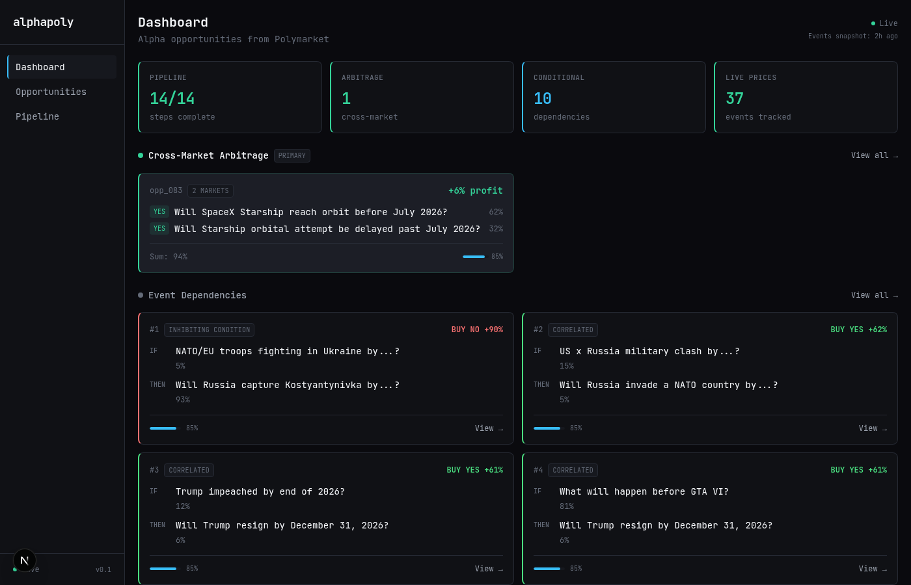

<p>
 <h3 align="center">Chainstack is the leading suite of services connecting developers with Web3 infrastructure</h3>
</p>

<p align="center">
  • <a target="_blank" href="https://chainstack.com/?utm_source=github&utm_medium=referral&utm_campaign=polymarket-alpha-bot">Homepage</a> •
  <a target="_blank" href="https://chainstack.com/protocols/?utm_source=github&utm_medium=referral&utm_campaign=polymarket-alpha-bot">Supported protocols</a> •
  <a target="_blank" href="https://chainstack.com/blog/?utm_source=github&utm_medium=referral&utm_campaign=polymarket-alpha-bot">Chainstack blog</a> •
  <a target="_blank" href="https://docs.chainstack.com/reference/blockchain-apis?utm_source=github&utm_medium=referral&utm_campaign=polymarket-alpha-bot">Blockchain API reference</a> • <br>
  • <a target="_blank" href="https://console.chainstack.com/sign-up?utm_source=github&utm_medium=referral&utm_campaign=polymarket-alpha-bot">Start for free</a> •
</p>

**Alphapoly** finds hedging pairs across correlated **Polymarket** markets and lets you trade them from a dashboard. An LLM pipeline groups related markets and finds where one outcome logically implies another; rule-based checks and a second LLM pass then reject pairs where both legs could lose. The dashboard streams live prices, buys a pair after showing its total cost against your balance, and tracks the P&L of your positions.

> **Also by Chainstack**
> - [**polyclaw**](https://github.com/chainstacklabs/polyclaw) — agent skill that lets an AI assistant browse and trade Polymarket from chat.

---

**🚨 Scam alert:** scam bots post in Issues with links to sites that drain your wallet. Never share your private key, and don't follow links in issue comments. Deleted comments were scams; genuine contributors are welcome.

**⚠️ Not for production:** this code is for learning, it isn't audited, and it isn't financial advice. Trading spends real funds. Polymarket restricts trading in some regions; check that you're allowed to trade where you are.

---



## How it works

1. **Groups** — fetches Polymarket events and groups their markets
2. **Implications** *(LLM)* — finds groups where one outcome logically implies another
3. **Validation** — rules reject pairs where some outcome makes both legs lose and skip pairs costing $1 or more; an LLM checks the rest market by market
4. **Portfolios** — cost, coverage, and expected profit for each valid pair at live prices
5. **Positions** — the pairs you bought, with P&L from what the exchange actually paid

## Getting started

### 1. Prerequisites

- [uv](https://docs.astral.sh/uv/getting-started/installation/) — it handles Python, no separate install needed
- **Node.js 20.9+**, via [fnm](https://github.com/Schniz/fnm), nvm, or brew
- An [OpenRouter API key](https://openrouter.ai/settings/keys) for the pipeline
- A Polygon RPC endpoint for balances and trading — deploy a Polygon node on [Chainstack](https://console.chainstack.com/sign-up?utm_source=github&utm_medium=referral&utm_campaign=polymarket-alpha-bot)

### 2. Install and run

```bash
cp .env.example .env      # then fill in the variables below
make install
make dev
```

Dashboard: http://localhost:3000 · API docs: http://localhost:8000/docs

### 3. Configure `.env`

| Variable | Needed | Purpose |
|---|---|---|
| `OPENROUTER_API_KEY` | Yes | LLM access |
| `IMPLICATIONS_MODEL` | Yes | OpenRouter model that finds implications |
| `VALIDATION_MODEL` | Yes | OpenRouter model that validates pairs; a stronger model rejects far more bad pairs |
| `CHAINSTACK_NODE` | For trading | Polygon RPC endpoint |
| `POLYMARKET_TAG` | No | Market category to scan; defaults to `politics` |
| `MARKET_POLLING_ENABLED` | No | Poll for new markets in the background; defaults to `true` |
| `POLL_INTERVAL_SECONDS` | No | Polling interval; defaults to `60` |
| `ALLOWED_ORIGINS` | No | Origins allowed to call the API; defaults to the local dashboard |

### 4. Find pairs

Run the pipeline from the dashboard, or:

```bash
make pipeline         # new markets only, reuses cached LLM results
make pipeline-full    # everything from scratch (more LLM calls)
```

### 5. Set up trading

Polymarket trades from a **deposit wallet**: a smart wallet owned by your signing key, with gas paid by Polymarket's relayer. In the dashboard's wallet menu:

1. Generate or import a signing key. It's stored encrypted with your password.
2. Add a Relayer API key, created at polymarket.com/settings?tab=api-keys while signed in with that key's wallet.
3. Deploy the deposit wallet (free), then send pUSD to it.

Lost the password? **Forgot password? Replace wallet** in the same menu moves the encrypted key aside (kept in `backend/data/`, not deleted) so you can generate or import another one. Positions are listed per deposit wallet: another wallet's positions stay on disk and show again when that wallet is imported back.

Holding USDC.e? Wrap it 1:1 into pUSD straight into the deposit wallet with [`experiments/trading/02_wrap_to_pusd.py`](experiments/trading/02_wrap_to_pusd.py) (`WRAP_TO=<deposit wallet>`).

## Commands

| Command | Does |
|---|---|
| `make install` | Install backend and frontend dependencies |
| `make dev` / `make stop` | Start or stop both servers (`make backend`, `make frontend` for one) |
| `make pipeline` / `make pipeline-full` | Run the pipeline incrementally or from scratch |
| `make export-seed` / `make import-seed` | Save the pipeline state as seed data, or reset to it |
| `make lint` | Fix with ruff, prettier, and eslint |

Without `make`: `cd backend && uv sync && uv run python -m uvicorn server.main:app --port 8000`, and `cd frontend && npm install && npm run dev`.

## Agentic coding

- **[`CLAUDE.md`](CLAUDE.md)** — project context, commands, conventions, and API routes. [`AGENTS.md`](AGENTS.md) links to it for Codex, Cursor, Copilot, and others.
- **`.claude/hooks/`** — Claude Code hooks: lint on every edit, and a block on edits to `.env`, `data/`, and key files.
- **`.claude/skills/`** — [Agent Skills](https://agentskills.io/home) for working with the app:

| Skill | Purpose |
|---|---|
| `alphapoly-pipeline` | Run, debug, and manage the pipeline |
| `alphapoly-portfolios` | List current hedging pairs |
| `alphapoly-enter-position` | Buy a pair |
| `alphapoly-exit-position` | Sell, merge, exit, or redeem a position |
| `alphapoly-feature` | Add a feature following the stack's conventions |
| `alphapoly-experiment` | Start a standalone experiment script |

## Experiments

Standalone scripts that don't import from `backend/`:

| Folder | What's there |
|---|---|
| [`experiments/`](experiments/) | One script per pipeline step, from fetching events to streaming prices |
| [`experiments/trading/`](experiments/trading/) | Deposit wallet setup, USDC.e ↔ pUSD wrapping, buying, token transfers |
| [`experiments/onchain-otc/`](experiments/onchain-otc/) | Trading without the order book (split/merge, escrow, intents) on a Polygon fork; standard (v1) markets only |

## Contributing

Open an **Issue** for feedback or bugs. CI runs ruff and pytest on the backend, and prettier, eslint, typecheck, and a build on the frontend; `make lint` and `cd backend && uv run pytest` cover the same locally.

## License

[Apache 2.0](LICENSE)
